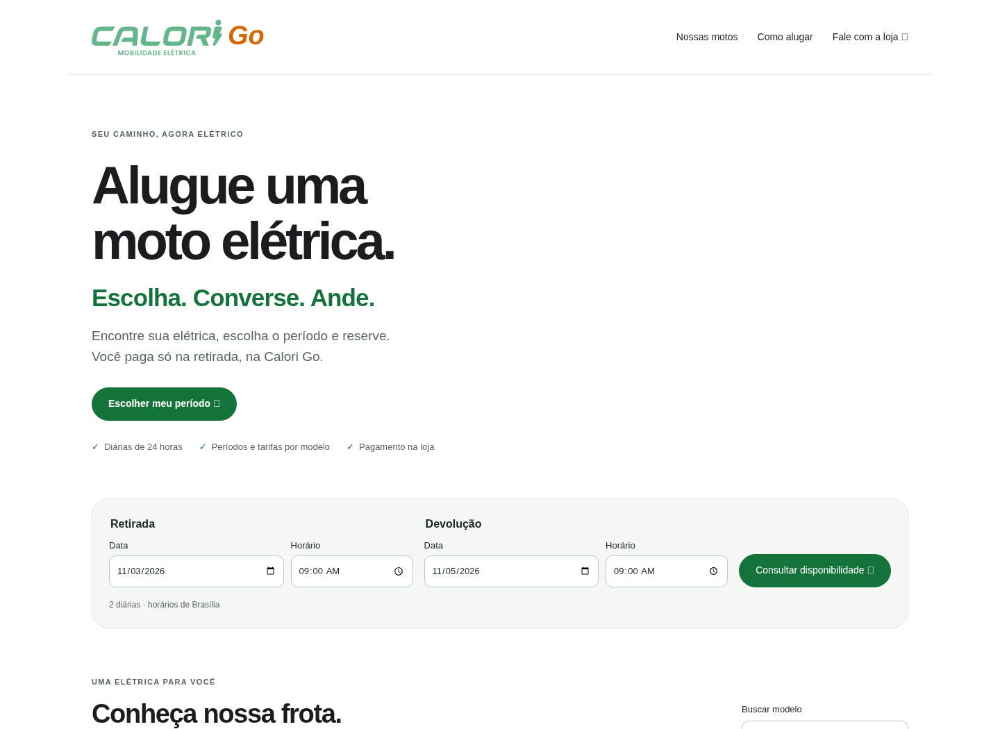
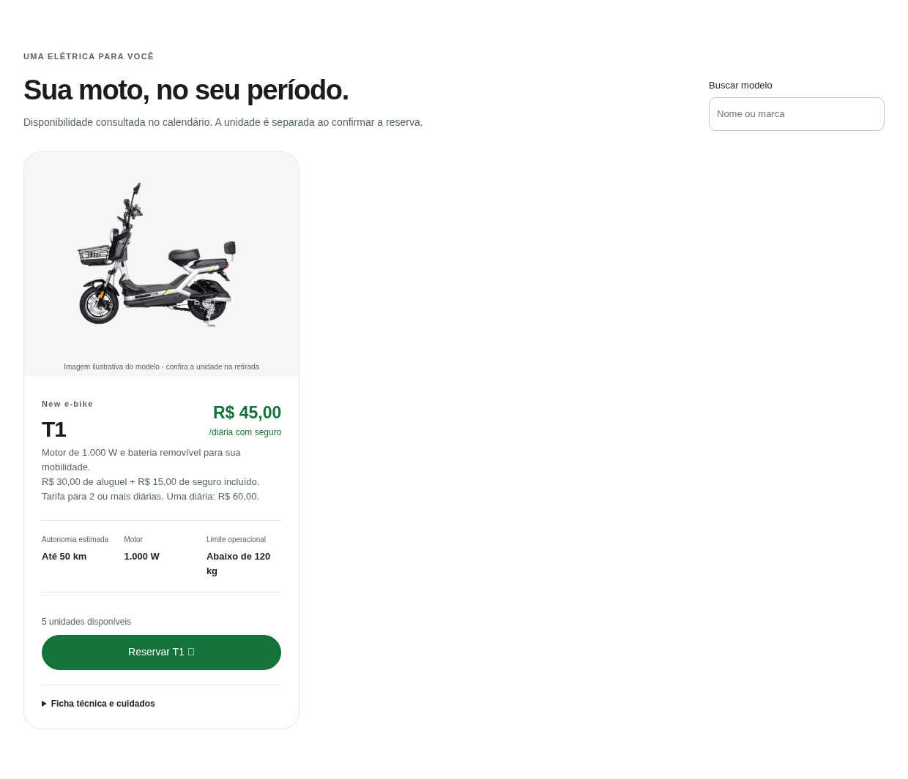
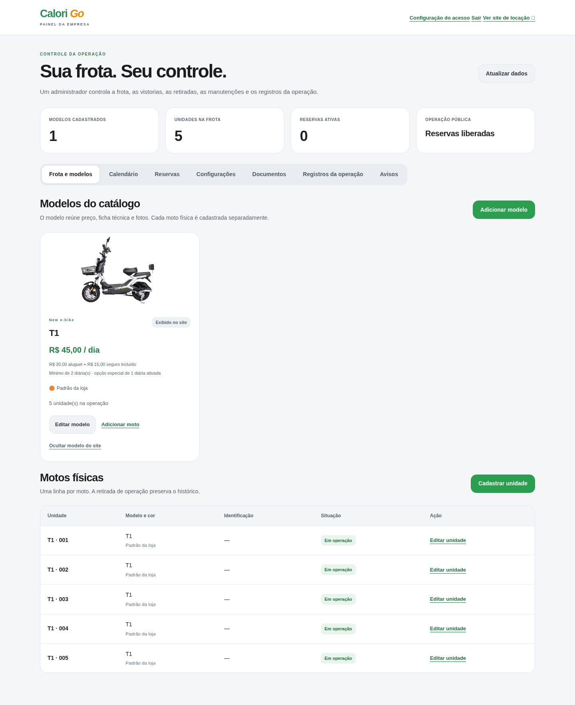
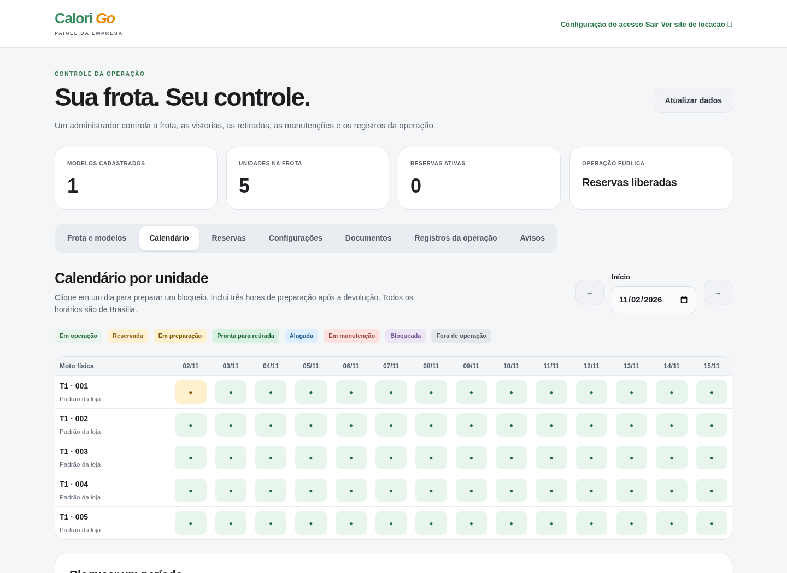
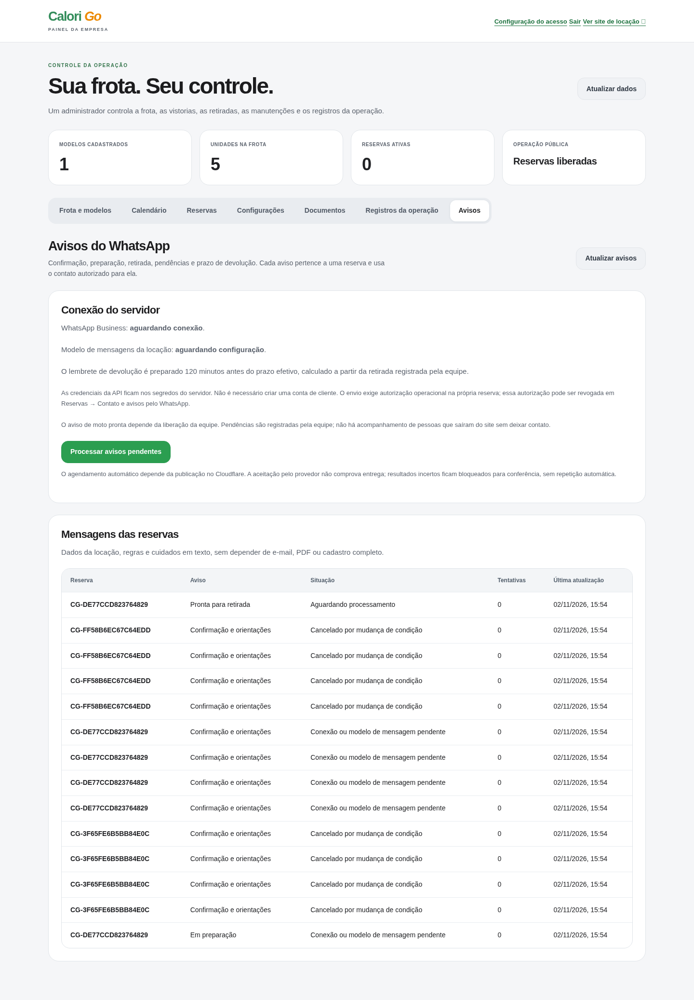

# Prévia visual da CaloriMob

Capturas reais da versão de demonstração, feitas em 02/11/2026. Os dados e reservas são fictícios e locais. Esta galeria apresenta as telas; não executa reservas nem envia mensagens. O envio real ainda depende de configurar a API da Meta na hospedagem.

## O que o cliente acessa

A página pública apresenta o período da locação, os modelos e a disponibilidade. A T1 não possui seletor público de cor. O cliente informa somente WhatsApp e nome opcional, aceita as condições e recebe o número da reserva. O pagamento é presencial; a retirada depende da liberação da equipe.

### Página inicial

### Modelo T1 e disponibilidade

### Reserva sem criar conta

## O que o administrador controla

O painel tem login próprio e reúne modelos, unidades físicas, valores, calendário, reservas, vistorias, ocorrências, condições e avisos. As ações de reservar, liberar, retirar e devolver usam o mesmo estoque.

### Frota, preços e modelos

### Cada moto física

### Calendário de disponibilidade

### Avisos no WhatsApp

## Fluxo da estrutura

Cliente → consulta de datas → modelo disponível → contato e aceite → número da reserva.

Administrador → preparação e vistoria → liberação para retirada → retirada e prazo efetivo → devolução e vistoria.

Servidor → D1 com estoque, reserva e contato mínimo → fila de WhatsApp conforme os eventos registrados pela equipe.

A confirmação da reserva não significa moto pronta. O aviso de retirada depende da liberação real no painel. A identificação completa e a assinatura são conferidas na loja.

[Como publicar no Cloudflare](../PUBLICAR-CLOUDFLARE-PELO-PAINEL.md) · [Operação sem conta de cliente](../NOVO-FLUXO-SEM-CADASTRO.md)
